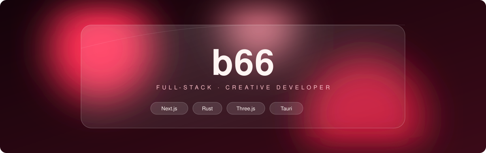

<!-- theme: Ruby Glass -->
<!-- accent: ff4f7b -->

  

  

  

<h3 align="center">♦ ABOUT ♦</h3>

<table align="center">
<tr>
<td align="center" width="25%">⚛️ <b>Web</b> Next.js · React TypeScript · Tailwind</td>
<td align="center" width="25%">🦀 <b>Desktop</b> Tauri + Rust C++ / Qt</td>
<td align="center" width="25%">🧊 <b>3D &amp; Motion</b> Three.js · GSAP Blender</td>
<td align="center" width="25%">🛠️ <b>Backend</b> Node · Bun · Express MongoDB · Firebase</td>
</tr>
</table>

🇵🇰 Developer from Pakistan — frontend at heart, full-stack in practice

<h3 align="center">♦ TOKEN FLEX ♦</h3>

<!-- TOKEN-FLEX:START -->

  

<!-- TOKEN-FLEX:END -->

<h3 align="center">♦ STACK ♦</h3>

  

<h3 align="center">♦ STATS ♦</h3>

  
  

  

  

