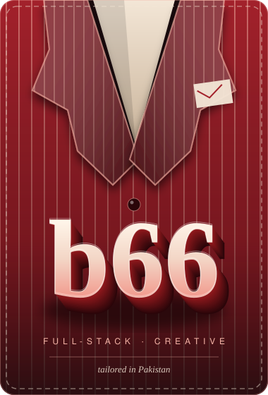
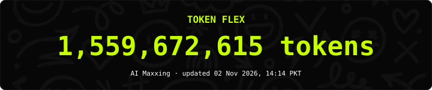

<!-- theme: Crimson Pinstripe -->
<!-- accent: ff4d5a -->

  

  

  

<h2 align="center">✦ THE FITTING ✦</h2>

  🇵🇰 Developer from <b>Pakistan</b> · frontend at heart, full-stack in practice 
  ⚛️ <b>Next.js · React · TypeScript · Tailwind</b> 
  🦀 <b>Tauri + Rust</b> desktop &amp; mobile, plus <b>C++ / Qt</b> 
  🧊 <b>Three.js · GSAP · Blender</b> for 3D &amp; motion 
  🛠️ <b>Node · Bun · Express · MongoDB · Firebase</b> on the back

<h2 align="center">✦ TOKEN FLEX ✦</h2>

<!-- TOKEN-FLEX:START -->

  

<!-- TOKEN-FLEX:END -->

<h2 align="center">✦ THE WARDROBE ✦</h2>

  

<h2 align="center">✦ THE RECORD ✦</h2>

  
  

  

  

