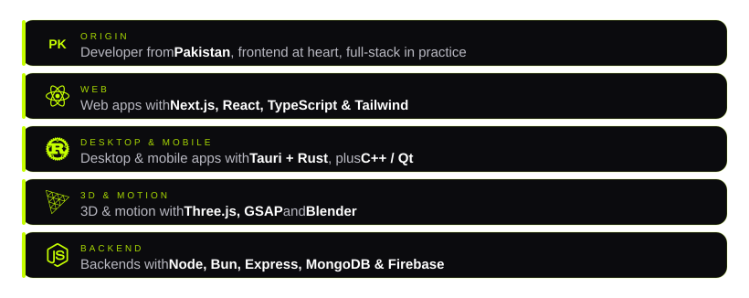
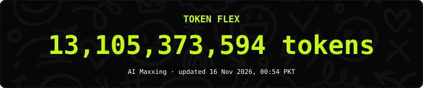
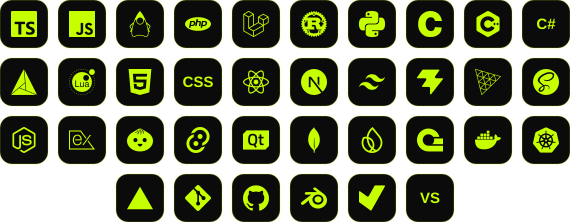

<!-- theme: Lime Skyline (original) -->
<!-- accent: c6ff00 -->

  

  

  

## `01 — ABOUT`

  

## `02 — TOKEN FLEX`

<!-- TOKEN-FLEX:START -->

  

  

<!-- TOKEN-FLEX:END -->

## `03 — STACK`

  

## `04 — STATS`

  

