  

  

  
  

## `01 — ABOUT`

- 🇵🇰 Developer from **Pakistan**, frontend at heart, full-stack in practice
- ⚛️ Web apps with **Next.js, React, TypeScript & Tailwind**
- 🦀 Desktop & mobile apps with **Tauri + Rust**, plus **C++ / Qt**
- 🧊 3D & motion with **Three.js, GSAP** and **Blender**
- 🛠️ Backends with **Node, Bun, Express, MongoDB & Firebase**

## `02 — TOKEN FLEX`

<!-- TOKEN-FLEX:START -->

  

<!-- TOKEN-FLEX:END -->

## `03 — STACK`

  

## `04 — STATS`

  
  

  

  

