  

  

  
  
  

## `02 — ABOUT`

- 🇵🇰 Developer from **Pakistan**, frontend at heart, full-stack in practice
- ⚛️ Web apps with **Next.js, React, TypeScript & Tailwind**
- 🦀 Native desktop & mobile apps with **Tauri + Rust**, plus some **C++ / Qt**
- 🎮 Motion & 3D with **GSAP, Three.js** and **Blender**
- 📫 Reach me at **54587dfdd@gmail.com**

## `03 — STACK`

**Languages**

  

**Frontend & Motion**

  
  

**Backend, Desktop & Data**

  

**DevOps & Tools**

  

## `04 — STATS`

  
  

  

  

  

  

